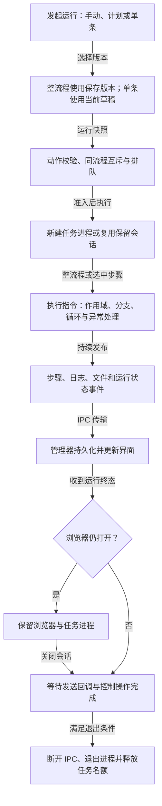

# 当前流程执行图

更新日期：2026-10-09。依据当前实现，包含整流程运行、计划触发、单条调试、XLSX、电脑键鼠和任务事件收尾。

## 执行主链路



事件在执行过程中持续传输，并非所有指令完成后才统一发送。图中“收到运行终态”表示成功、失败或停止后进入会话收尾；失败或停止仍走同一个收尾检查。任务进程退出条件为：执行已结束、控制操作数为零、待发送消息数为零、浏览器已关闭。IPC 发送回调完成不等于文件已落盘；文件写入由管理器和 `FileStore` 的队列负责，等待运行结束时会刷新存储队列。

管理器默认并发为 2，桌面可通过 `RPA_MAX_CONCURRENT` 配置。保留浏览器的任务进程仍占用并发名额及配置租约，后续任务可能继续排队。

## 运行入口与版本

| 入口 | 执行版本 | 浏览器处理 |
| --- | --- | --- |
| 整流程手动运行 | 必须与已保存的修订版本一致，创建运行快照 | 重跑前先关闭同流程或同配置的保留浏览器，再创建新任务；正在取点时拒绝重跑 |
| 定时运行 | 从存储读取流程；支持单次、每日、固定分钟间隔 | 进入同一运行管理器，沿用整流程准入及会话规则 |
| 单条运行，新会话 | 使用当前草稿，校验选中步骤及祖先容器 | 网页操作通常须先运行“打开网页”；无需浏览器的指令可直接执行 |
| 单条运行，复用会话 | 使用当前草稿，并覆盖该会话的运行快照 | 复用同流程已结束任务的页面和变量；配置、无头模式须匹配，执行、控制或取点期间拒绝复用 |

单条运行选中容器时执行其子步骤；直接运行嵌套子步骤只继承祖先的变量、元素和设置，不执行祖先动作，不自动创建循环项或 Catch 变量。已注释步骤及其后代不能单独运行；整流程执行时则跳过已注释的步骤树。

## 指令执行能力

| 指令类别 | 当前实现 |
| --- | --- |
| `browser.*` | Playwright 会话、多个网页、元素与 iframe、文本和表格、下载与响应、网页坐标和键盘、弹窗屏蔽 |
| `script.run` | Python、JavaScript、TypeScript 独立进程；通过 JSON RPC 调用当前执行器和浏览器，读写运行变量 |
| `file.xlsxRead` / `file.xlsxWrite` / `control.forEachXlsx` | XLSX 读写和按行遍历；循环项作用域恢复、整行数组或对象、固定列值；支持 ZIP64 输入 |
| `desktop.*` | Windows 当前前台窗口的真实键鼠输入、物理屏幕坐标、F8 取点、真人轨迹和剪贴板粘贴 |
| `core.*` / `control.*` | 变量、断言、打印日志、备注、等待、条件、列表循环和 Try Catch；容器期限、暂停和取消 |

安全读取和校验动作可按配置重试或失败暂停；点击、下载、脚本等有外部效果的动作拒绝自动重试和失败后重跑。Try Catch 不捕获用户主动停止。电脑键鼠会占用系统输入，尚无键鼠空闲检测或前台仲裁。

## 事件与浏览器生命周期

运行事件完整保存在 `events.jsonl`，运行快照保存在 `run.json`，执行版本保存在运行目录的 `workflow.json`。界面日志默认隐藏普通步骤的执行中、完成和跳过信息，保留输出、产物、失败和运行状态；“显示指令执行信息”及“步骤”筛选可查看详细执行事件，偏好保存在本机。

默认保留浏览器。整流程成功且设置 `keepBrowserOpen: false` 时，先关闭浏览器再发送运行终态；单条运行始终选择保留策略。失败可保留浏览器现场，主动停止和退出程序会请求清理会话。手动关闭浏览器后，发送更新的会话状态，等待消息和控制操作完成再退出任务进程。任务进程异常退出且尚未收到运行终态时，管理器记录为意外中断。

大变量或 XLSX 结果会使 IPC 消息排队，`worker.ts` 使用 `pendingSends` 跟踪发送回调，避免消息尚未送完就断开连接而丢失日志或终态。此行为已由真实 Electron 任务进程测试覆盖成功、失败及停止路径。

## 代码依据与图源

| 说明 | 代码依据 |
| --- | --- |
| 请求入口、计划、排队、整流程重跑和单条复用 | [`apps/runner/src/manager.ts`](../apps/runner/src/manager.ts) |
| IPC 发送回调和任务进程退出条件 | [`apps/runner/src/worker.ts`](../apps/runner/src/worker.ts) |
| 指令、作用域、控制流及终态前的浏览器处理 | [`packages/engine/src/index.ts`](../packages/engine/src/index.ts) |
| 文件队列及事件、快照持久化 | [`packages/persistence/src/index.ts`](../packages/persistence/src/index.ts) |
| 日志显示和本机偏好 | [`LogViewer.tsx`](../apps/desktop/src/renderer/LogViewer.tsx)、[`log-view.ts`](../apps/desktop/src/renderer/log-view.ts) |
| IPC 积压的成功、失败和停止验证 | [`tests/worker-events.test.ts`](../tests/worker-events.test.ts) |

Archify 可编辑图源为 [`diagrams/rpa-execution.workflow.json`](diagrams/rpa-execution.workflow.json)，使用 workflow schema v2、中文界面与 showcase 检查。上方 Mermaid 供 GitHub 直接阅读；拓扑与图源一致。

安装 Archify 技能后，可在仓库根目录生成交互 HTML 并采集浏览器证据：

```powershell
$archifyCli = Join-Path $env:USERPROFILE '.codex\skills\archify\bin\archify.mjs'
node $archifyCli validate workflow docs/diagrams/rpa-execution.workflow.json --quality showcase --json
node $archifyCli deliver workflow docs/diagrams/rpa-execution.workflow.json .rpa/qa/rpa-execution.html --quality showcase --json
node $archifyCli visual-check .rpa/qa/rpa-execution.html --json
```

Git 只保存本文和可编辑 JSON 图源。HTML、截图和验收回执位于忽略的 `.rpa/qa/`，按仓库约定不提交生成产物。
